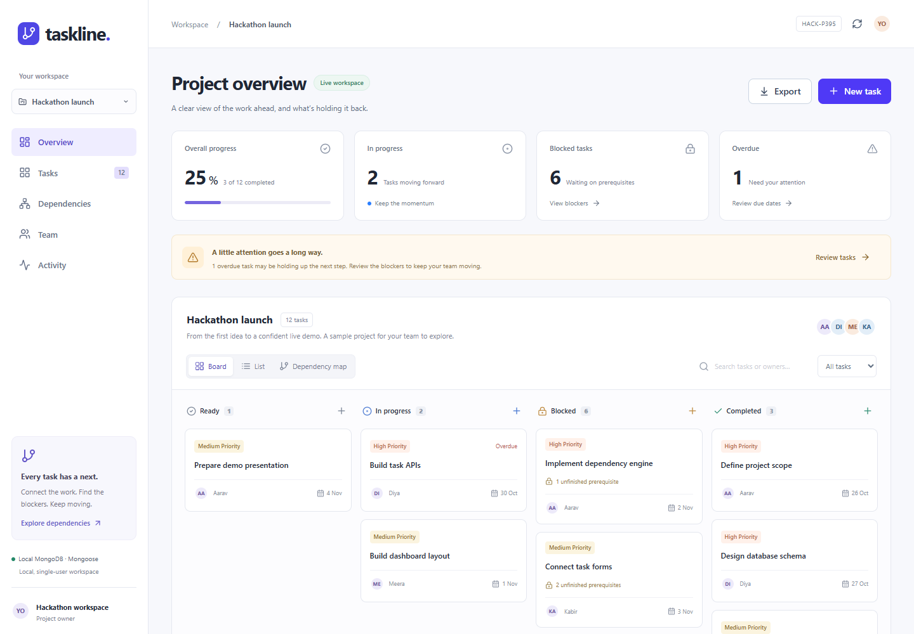

# Taskline — Project Dependency Manager

Hackathon problem: **HACK-P395**. A working local web application for organizing tasks, validating dependencies, and finding blocked work.

## Open the project

Clone this repository and install Node.js 22.12+ (Node 24 recommended):

```sh
git clone https://github.com/ravitejavegi28-eng/taskline-dependency-manager.git
cd taskline-dependency-manager
npm install
npm run build
npm start
```

Open **http://127.0.0.1:4173** after the ready message. On Windows, after installation and building, you can also double-click **RUN-TASKLINE.cmd**. Keep its window open while using the app.

A `pnpm-lock.yaml` is included for exact dependency resolution with pnpm. With pnpm installed, use `pnpm install --frozen-lockfile`, `pnpm build`, and `pnpm start` instead.

For development use `npm run dev`. Both modes serve the frontend and API from the same local address. To stop, press Ctrl+C.

## Database and connector

- **Database:** MongoDB.
- **Connector / object document mapper:** Mongoose, running in the Express backend. It uses the MongoDB Node.js driver underneath.
- **Local default:** `mongodb-memory-server-core` starts a real MongoDB 7.0.14 process, configured with the WiredTiger engine and a persistent `data/mongodb` directory. Despite the package name, the application uses disk storage. The first launch downloads a roughly 592 MB MongoDB distribution into `data/binaries`; internet is needed once for this download.
- **Own database:** copy `.env.example` to `.env` and set `MONGODB_URI` to a local MongoDB or MongoDB Atlas connection string. Never put that string in frontend code or commit `.env`. An invalid supplied connection does not silently fall back to another database.
- Project changes survive refresh and normal application restarts. Back up the database before deleting the `data` directory. Export creates a readable project JSON snapshot; import/restore is not implemented.

## Technology

| Layer | Technology | Responsibility |
|---|---|---|
| Interface | React + TypeScript + Vite | Board, list, forms, dashboard |
| Styling | Tailwind CSS + shared CSS tokens | Responsive layout and state styling |
| Components | shadcn-style reusable Button and Dialog; Radix Dialog, Slot, CVA | Accessible controls and modal focus management |
| Visualization | React Flow (`@xyflow/react`) | Dependency nodes, links, zoom and pan |
| API | Node.js + Express | Validation, graph rules, saving changes |
| Database | MongoDB + Mongoose | Persistent project documents and typed schemas |

Design guidance: **ui-ux-pro-max** and **ui-styling**. Source design decisions are recorded in `DESIGN.md`. React Flow displays links; the backend implements graph validation independently.

## Preview



## Included features

- Multiple projects; create a project and switch between projects.
- Create, edit, assign, prioritize, and delete tasks with titles, descriptions, due dates, and status.
- Add/remove prerequisites with checkboxes, or connect graph handles from prerequisite to dependent task.
- Four derived board states: Ready, In progress, Blocked, Completed.
- Reject self-dependencies, cycles, duplicate dependencies, missing tasks, invalid dates, and invalid statuses.
- Highlight all downstream tasks with an impact preview. This is a reachability preview, not a predicted completion date.
- Dashboard: completion progress, in-progress count, blocked count, overdue count, blockers and recent activity.
- Search by task title/owner and filter board/list by status or overdue. The graph intentionally retains the full project context.
- Project JSON export, latest 50 activity events, and protection against stale writes from another browser window.
- Seeded project with 12 fictional tasks, four owners, and multiple dependency chains.

## How dependency logic works

The project is a directed acyclic graph. An edge A → B means B requires A to finish first. Each task stores predecessor IDs in `dependencies`.

Before saving, the backend builds an adjacency map and runs **Kahn's topological algorithm**. If it cannot visit every task, the candidate graph contains a cycle and the save is rejected. Topological depth also provides graph columns. A breadth-first traversal of child links finds downstream impact.

A task is Blocked when any prerequisite is unfinished. Otherwise `todo` displays as Ready, while in-progress/completed retain their states. The backend rejects starting or completing blocked tasks. It also rejects reopening a prerequisite when that would leave an active/completed dependent with an unfinished prerequisite. Return affected dependents to Ready first, from downstream to upstream, then reopen the prerequisite. This is an intentional consistency rule, not an automatic cascade.

Deletion removes the task and its direct dependency links after confirmation. Remaining task state is recomputed; deletion is irreversible. A maximum of 150 tasks per project keeps this prototype manageable.

Graph validation and a single impact traversal take **O(V + E)** time and space. Sorting blocker rankings currently performs multiple traversals, so the whole dashboard is not claimed to run in linear time. Each save sends a complete project task array and uses an atomic MongoDB revision check to avoid overwriting another window's newer changes.

## Verify

```sh
npm run check
npm test
npm run build
```

Tests cover graph correctness and use a separate temporary real MongoDB instance for API integration. The integration test reuses the downloaded binary and does not change your project database.

## Access and limitations

This is a **local, single-user hackathon prototype**, bound to 127.0.0.1. Owner names identify task assignments, not authenticated accounts. There is no login, multi-user permission system, or cloud deployment. Local host checks and cross-origin mutation rejection reduce accidental browser access; they are not a replacement for authentication. Do not expose this server publicly.

No critical-path calculations, duration-based scheduling, Gantt chart, email notifications, or calendar integrations are claimed. The app does not use an AI API. All sample people and tasks are fictional. MongoDB Atlas is supported through configuration but not provisioned by the app.

## Files

- `src/App.tsx`: screens, forms, board and list.
- `src/DependencyGraph.tsx`: lazy-loaded graph visualization.
- `src/components/ui/index.tsx`: shared components.
- `server/graph.js`: graph validation and impact traversal.
- `server/app.js`: API validation and persistence operations.
- `server/db.js`: MongoDB startup, Mongoose models and connector.
- `server/seed.js`: sample project.
- `tests/`: graph and real-database integration tests.
- `TEACHER-GUIDE.md`: architecture explanation, demo and viva preparation.

## Button verification

See [BUTTON-AUDIT.md](BUTTON-AUDIT.md) for the completed browser interaction audit and [VERIFICATION.md](VERIFICATION.md) for API and build checks.

## Optional MongoDB Atlas setup

You do not need Atlas for the local demo. If you choose to use your Atlas account, create a cluster and a project-specific database user in Atlas, allow only the IP addresses you need, and put the Atlas connection string in your local `.env` as `MONGODB_URI`. Use `taskline` as the database name. Mongoose creates the project collection on the first run, so a manually created collection is unnecessary. Keep the connection string private; it must never be pasted into GitHub or frontend code. The local default works without any Atlas credentials.

## Submission scope

This repository contains the complete local hackathon prototype and documentation. A GitHub repository hosts the source code; it does not automatically host the Express server or MongoDB database. Your teacher can clone the project and run it using the instructions above.

## Re-run the complete browser audit

After dependency installation, install the test browser once:

```sh
npx playwright install chromium
npm run build
npm run test:browser
```

The audit starts a separate temporary MongoDB instance, creates disposable test projects, tests the controls, and shuts down the test server and database. It does not change the default workspace. You can use an already installed compatible browser by setting `TASKLINE_BROWSER_PATH` to its executable.
