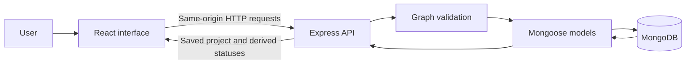

# Presenting Taskline to your teacher

## What we built

Taskline is a Project Dependency Manager for problem HACK-P395. A team creates tasks and records which tasks must finish before others can begin. The app prevents circular relationships, explains blocked work, and highlights downstream impact.

## What did you use?

The frontend uses React and TypeScript. The server uses Node.js and Express. MongoDB stores project and task data. Mongoose connects the server to MongoDB, defines document schemas, and performs database operations. React Flow draws the dependency graph. Tailwind CSS, shared design tokens, and Radix-based components provide the interface.

The two requested design skills, ui-ux-pro-max and ui-styling, guided the dashboard layout, styling, keyboard focus, forms, and responsive behaviour.

## Architecture

Mongoose runs on the server. The browser does not connect directly to MongoDB or receive the database connection string.

## Database model

One project document contains:

- A unique project ID, name, description, and revision number.
- Embedded tasks with ID, title, description, owner, due date, priority, status, predecessor IDs and creation timestamp.
- The latest 50 activity events.

Embedding makes saving a task graph and its revision one atomic document operation. This is convenient for a capped, small-project prototype. Larger team products would need more granular records, authentication, indexes and a stronger audit history.

Derived values such as Blocked/Ready, graph depth, and blocker IDs are computed from stored tasks, not trusted from the browser.

## Four-minute demonstration

1. **Problem and overview (30 seconds):** Explain that a task list alone does not show which unfinished work holds up other tasks. Open the seeded Hackathon launch project and show its dashboard.
2. **Inspect a blocker (45 seconds):** Open Build task APIs. Show its owner, overdue date, prerequisites and downstream count. Choose Preview impact and explain the highlighted descendants.
3. **Unlock work (45 seconds):** Return to Build task APIs and mark it Completed. Show that Implement dependency engine becomes Ready. Connect task forms remains blocked until Build dashboard layout is also complete.
4. **Reject a cycle (45 seconds):** Edit Build task APIs and add Implement dependency engine as a prerequisite. It already depends on Build task APIs, so the save must fail with a circular dependency error. Cancel the edit. No invalid data is saved.
5. **Persistence and architecture (45 seconds):** Refresh and show the previous valid change remains. Explain React → Express → graph validation → Mongoose → MongoDB.
6. **Limitations (30 seconds):** Explain that this is a local single-user prototype, impact is a reachability preview, and advanced critical-path scheduling is not implemented.

Use only synthetic data. Repeat demonstrations on a new project if you want to keep the seeded project unchanged.

## Likely questions

**What is the database connector?**
Mongoose. It is an object document mapper for Node.js and uses the MongoDB driver underneath.

**Is the database real or simulated?**
Real MongoDB. By default a local MongoDB process runs with WiredTiger disk storage in data/mongodb. Alternatively MONGODB_URI points to a separately managed local MongoDB or Atlas deployment. It is not browser localStorage.

**How do you prevent a cycle?**
The backend checks the entire proposed graph with Kahn's topological algorithm before writing. If fewer than all tasks can be visited, a cycle exists and the save is rejected. Self-links and missing IDs have their own validation.

**How do you find affected tasks?**
Build child adjacency links and traverse from the selected task. A visited set ensures a shared descendant is included once.

**Does React Flow implement your validation?**
No. React Flow displays nodes and edges. The backend contains the authoritative graph rules, so an invalid direct API request is also rejected.

**What happens when a prerequisite is completed?**
The dependent task becomes Ready if all other prerequisites are complete. Tasks stay Blocked while any prerequisite is unfinished.

**Can you reopen completed tasks?**
Yes, if doing so does not invalidate active or completed dependents. Otherwise return those downstream tasks to Ready first. The app deliberately rejects inconsistent transitions.

**What if two browser windows save at once?**
Each sends the project revision it read. MongoDB updates only if the stored revision still matches, then increments it. A stale save gets a conflict response and must refresh.

**Are assigned owners separate user accounts?**
No. They are assignment labels in a local single-user workspace. Multi-user authentication and permissions are a future improvement.

**Does it calculate the critical path?**
No. It displays prerequisite chains and downstream reachability. Critical path requires duration and scheduling rules beyond the implemented scope.

**Did you use AI?**
Explain your actual process honestly. This project was built with AI assistance. Before presenting it, run it yourself, read the graph logic, and be able to explain the tests, technology choices, and changes you made. Do not claim that every line was written manually by your team.

## Suggested real team contributions

Assign actual work rather than inventing retrospective contributions: one member can review and improve task workflows, another study and test graph rules, another verify API/database persistence, and another prepare the demo and responsive/accessibility checks. Record what each person really did.

## Hosted evaluator access

The app now supports Render with Atlas. Hosted mode uses one shared evaluator login (HTTP Basic over HTTPS), configured through private environment variables. It is not a multi-user permission system. Local mode remains available with no login. Read DEPLOYMENT.md for setup and health-check instructions.
