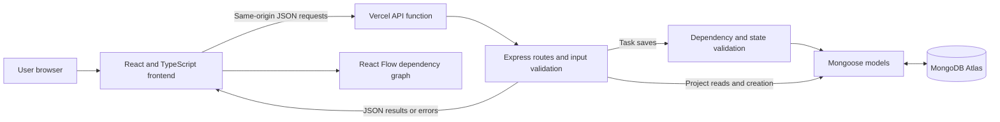
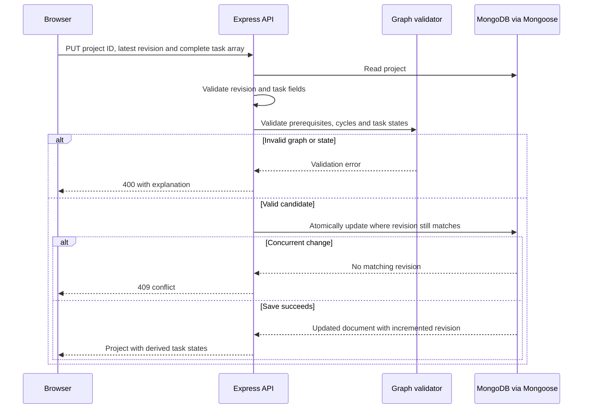

# Taskline system architecture

Taskline is a React application with an Express backend and MongoDB Atlas storage. Its current hosted version is a public shared demo without login.

## System diagram

## Responsibilities

| Component | Responsibility |
|---|---|
| React, TypeScript and Vite | Board, list, dashboard, forms and client state |
| Tailwind CSS and Radix-based components | Responsive styling, dialogs and keyboard interaction |
| React Flow | Display task nodes and dependency edges, selection and zoom |
| Vercel API adapter | Route nested API URLs and reuse initialization within a warm function |
| Express | Parse JSON, validate inputs, enforce graph rules and expose endpoints |
| Graph module | Kahn's topological validation, readiness, levels and downstream traversal |
| Mongoose | Define schemas and perform MongoDB operations |
| MongoDB Atlas | Persist project documents with embedded tasks and recent activity |

## Task-save flow

## Dependency processing

An edge A to B means B requires A to finish first. The backend builds adjacency and indegree maps and applies Kahn's topological algorithm. Visiting fewer than all tasks indicates a cycle. A task is Blocked when any prerequisite is unfinished; otherwise todo displays as Ready. A traversal of child links identifies downstream impact. Graph validation and a single impact traversal use O(V + E) time and space; the whole dashboard is not claimed to run in linear time.

## Hosting and data handling

The frontend is served from the Vercel deployment and calls its same-origin API. The backend reads MONGODB_URI from private hosting environment variables. Database credentials are not shipped to the browser. Atlas network access must permit the deployed backend.

Local development uses the same Express and Mongoose modules, with a local MongoDB process when no URI is configured. Hosted environments require an explicit database URI and never start the local database process.

## Scope and limitations

There is no login, per-user authorization, critical-path calculation, duration-based scheduling, Gantt chart or notification service. All visitors to the hosted demo share editable data. Input validation, host/origin checks and revision protection remain in place, but do not constitute authentication. Use fictional records only.
