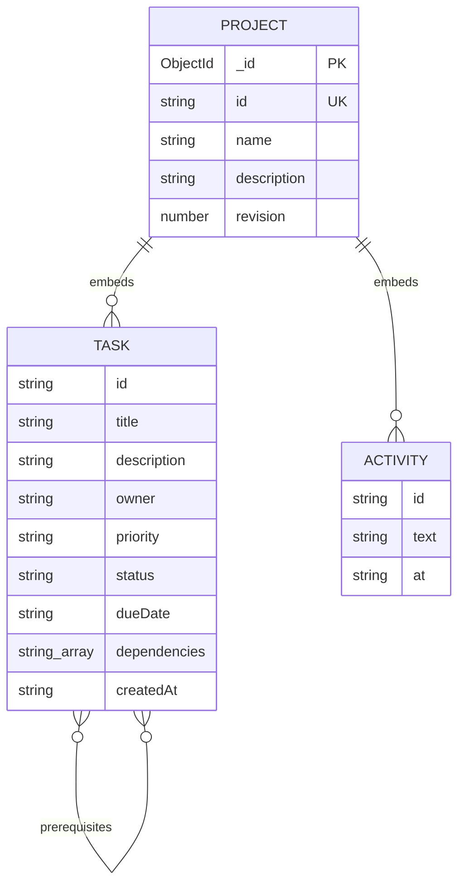

# Taskline database design

Database: MongoDB Atlas. Connector/object document mapper: Mongoose, using the MongoDB Node.js driver underneath.

Mongoose defines a Project model, normally stored in the projects collection. Tasks and activity events are embedded documents, not separate collections. Task dependencies contain application task IDs within the same project.

## Logical relationship diagram

The self-relationship represents directed prerequisites: a dependent task stores its predecessor IDs. Acyclicity is enforced in application validation, not through MongoDB foreign keys. Embedded tasks have no generated _id field; their application id identifies them within a project. Activity subdocuments also disable generated _id fields.

## Project fields

| Field | Storage and rules |
|---|---|
| _id | MongoDB-generated document identifier; omitted from API project responses |
| id | Required string with a unique index; generated by the application |
| name | Required string; API limit 80 characters |
| description | String; API limit 500 characters |
| revision | Number, default 0; incremented on each successful task-list save |
| tasks | Embedded Task array; API maximum 150 tasks |
| activity | Embedded Activity array; latest 50 events retained by the save endpoint |

## Embedded task fields

| Field | Storage and rules |
|---|---|
| id | Required string; API maximum 80 characters and unique within the project |
| title | Required string, maximum 120 characters |
| description | String, maximum 2000 characters |
| owner | String, maximum 60 characters; an assignment label, not a user account |
| priority | low, medium, or high |
| status | todo, in_progress, or completed |
| dueDate | String validated by the API as YYYY-MM-DD |
| dependencies | Array of predecessor task IDs within this project |
| createdAt | Server-generated ISO timestamp string; preserved for existing IDs |

## Embedded activity fields

| Field | Purpose |
|---|---|
| id | Application-generated event ID |
| text | Description supplied by the save request or the default update label |
| at | Server-generated ISO timestamp string |

Activity is a recent-change log, not a tamper-proof audit system. The event text is supplied by a public client and is not an authenticated user attribution.

## Derived response fields

blockers, displayStatus and level are calculated from the current dependency graph. They are not authoritative persisted fields. A todo task displays as Ready if all prerequisites are complete, otherwise as Blocked.

## Consistency and design choices

- The backend rejects missing dependencies, duplicates, self-links and cycles.
- Active/completed tasks cannot have unfinished prerequisites.
- A project and its task graph are saved in a single MongoDB document update.
- The update filters by both project id and expected revision; concurrent stale writes return 409.
- Task deletion removes the embedded task and its dependency references through the normal save endpoint.
- There are no separate user, membership, dependency-edge or notification collections.

Embedding suits this small, capped prototype. A larger multi-user product would need stronger access control, pagination, more granular update operations and appropriate indexing.

Source of truth: [Mongoose schemas](../server/db.js), [API validation](../server/app.js), and [graph rules](../server/graph.js).
